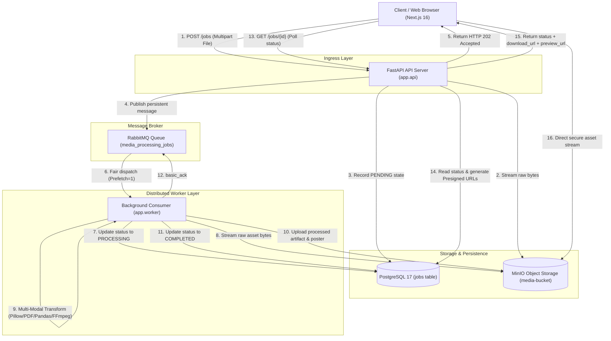

# MediaFlow - Distributed Multi-Modal Media Processing Platform

[-black?style=flat-square&logo=next.js)](https://nextjs.org/)
[](https://fastapi.tiangolo.com/)
[](https://www.rabbitmq.com/)
[](https://www.postgresql.org/)
[](https://min.io/)
[](https://tailwindcss.com/)

**MediaFlow** is a production-grade, distributed multi-modal media processing SaaS platform designed to handle CPU-intensive transformations asynchronously without blocking HTTP ingress. 

The system decouples API requests from background compute through a persistent **RabbitMQ** task queue, streams raw and processed assets directly through **MinIO (S3 API)**, tracks task lifecycle states in **PostgreSQL 17**, and delivers a real-time operational dashboard with interactive multi-modal asset previews built with **Next.js 16 (App Router)**.

---

## 1. Core Engineering Principles

1. **Sub-50ms Non-Blocking Ingress**: File uploads return HTTP `202 Accepted` immediately upon writing raw bytes to S3 and enqueuing the message. Heavy CPU transformations are delegated to background worker instances.
2. **Fair-Dispatch Queue Architecture**: Background workers configure `prefetch_count=1`, guaranteeing even distribution across worker containers without Head-of-Line queue starvation.
3. **Stateless Scalability**: No assets touch container filesystems permanently; all media streams directly via in-memory byte buffers (`io.BytesIO`) to MinIO.
4. **Fault-Isolated Poison-Pill Handling**: Corrupt or malformed files are caught at resilient boundaries, persisted as `FAILED` in PostgreSQL with exact tracebacks, and acknowledged to prevent infinite re-delivery loops.
5. **Direct-to-Client Asset Delivery**: Processed files and previews are delivered via cryptographically signed, time-bound S3 Presigned URLs (`3600s`), offloading bandwidth egress from the API server.
6. **Graceful OS Drain**: Workers intercept Linux `SIGINT` and `SIGTERM` signals to cleanly drain in-flight tasks before terminating.

---

## 2. Multi-Modal Processing Pipelines

MediaFlow classifies and processes assets across 4 distinct media categories:

| Format Category | Supported Formats | Engine | Processing Operation & Artifacts |
|---|---|---|---|
| **Images** | `.jpg`, `.jpeg`, `.png`, `.webp`, `.gif` | **Pillow** | 500×500 aspect-ratio preserving thumbnailing, RGB conversion, 85% JPEG compression. |
| **Documents** | `.pdf` | **PyMuPDF (`fitz`)** | Page count, title, and author metadata extraction, plus high-res Page 1 poster rendering (`150 DPI`). |
| **Tabular Datasets** | `.csv`, `.xlsx`, `.xls` | **Pandas & OpenPyXL** | Schema profiling, column data types, missing value counts, and top-10 preview rows (`summary.json`). |
| **Video** | `.mp4`, `.mov`, `.webm` | **FFmpeg** | Duration, resolution, codec, and framerate probing, plus 1.0s poster-frame extraction without queue blocking. |

---

## 3. High-Level System Architecture



---

## 4. API Endpoints

| Method | Endpoint | Description | Status Code |
| :--- | :--- | :--- | :--- |
| `GET` | `/health` | API server liveness check (supports `GET` and `HEAD`) | `200 OK` |
| `GET` | `/stats` | Live telemetry: RabbitMQ queue depth, consumer count & media type counts | `200 OK` |
| `POST` | `/jobs` | Upload asset and enqueue asynchronous multi-modal transformation | `202 Accepted` |
| `GET` | `/jobs` | List jobs with pagination, status filter, media format filter & search | `200 OK` |
| `GET` | `/jobs/{job_id}` | Query job state, timestamps, duration, error, and presigned S3 URLs | `200 OK` |

See [API_INTEGRATION.md](file:///home/saimon/Emon_work/project/Distributed_Media_Processing/API_INTEGRATION.md) for full request/response schemas.

---

## 5. Local Development Quickstart

### Prerequisites
- Docker & Docker Compose
- Node.js 18+ and npm
- Python 3.12+ (for running tests or local workers)

### Step 1: Start Backend Services (Docker Compose)
```bash
# Clone the repository
git clone https://github.com/saimonemon46/Distributed_Media_Processing.git
cd Distributed_Media_Processing

# Copy environment variables
cp .env.example .env

# Spin up all backend infrastructure (API, Worker, DB, MinIO, RabbitMQ)
docker compose up --build -d
```

Verify service availability:
- **FastAPI Ingress**: [http://localhost:8000/health](http://localhost:8000/health) (Swagger UI: [http://localhost:8000/docs](http://localhost:8000/docs))
- **MinIO Console**: [http://localhost:9001](http://localhost:9001) (`minioadmin` / `minioadminpassword`)
- **RabbitMQ Management**: [http://localhost:15672](http://localhost:15672) (`guest` / `guest`)

### Step 2: Start Frontend Application (Next.js 16)
```bash
cd frontend

# Install frontend dependencies
npm install

# Start development server
npm run dev
```

Visit [http://localhost:3000](http://localhost:3000) to access the **MediaFlow** SaaS dashboard.

---

## 6. Testing

### Run Integration Tests
Validates API health, end-to-end multi-modal processing (Image, CSV, PDF, and failure handling):
```bash
python test_app.py
```

### Run Backend Unit Tests
Hermetic in-memory SQLite unit tests verifying API endpoints and multi-modal MIME detection:
```bash
pytest test_backend_api.py
```

### Run Frontend Unit & Integration Tests
```bash
cd frontend
npm test
```

### Run Production Build Verification
```bash
cd frontend
npm run build
```

---

## 7. Cloud Deployment Guide

### Frontend Deployment: Vercel
1. Import repository into [Vercel](https://vercel.com/).
2. Set **Root Directory** to `frontend`.
3. Framework Preset: **Next.js**.
4. Configure Environment Variable:
   - `NEXT_PUBLIC_API_BASE_URL`: `https://your-api-domain.onrender.com`
5. Click **Deploy**.

### Backend Deployment: Render / Railway / AWS
1. **Database**: Provision a managed PostgreSQL instance (e.g. Render PostgreSQL, Supabase, Neon) and set `DATABASE_URL`.
2. **Message Broker**: Provision a managed RabbitMQ broker (e.g. [CloudAMQP](https://www.cloudamqp.com/)) and set `RABBITMQ_HOST`, `RABBITMQ_PORT`, `RABBITMQ_USER`, `RABBITMQ_PASSWORD`.
3. **Object Storage**: Provision an S3-compatible bucket (AWS S3, Cloudflare R2, or persistent MinIO) and configure `MINIO_ENDPOINT`, `MINIO_PUBLIC_ENDPOINT`, `MINIO_ACCESS_KEY`, `MINIO_SECRET_KEY`, and `MINIO_BUCKET_NAME`.
4. **FastAPI Web Service**:
   - Build command: `pip install -r requirements.txt`
   - Start command: `uvicorn main:app --host 0.0.0.0 --port $PORT`
   - Set `ALLOWED_ORIGINS` to your deployed Vercel frontend URL.
5. **Background Worker Service**:
   - Start command: `python worker.py`
   - Deploy as a background worker with identical database, broker, and storage environment variables.
