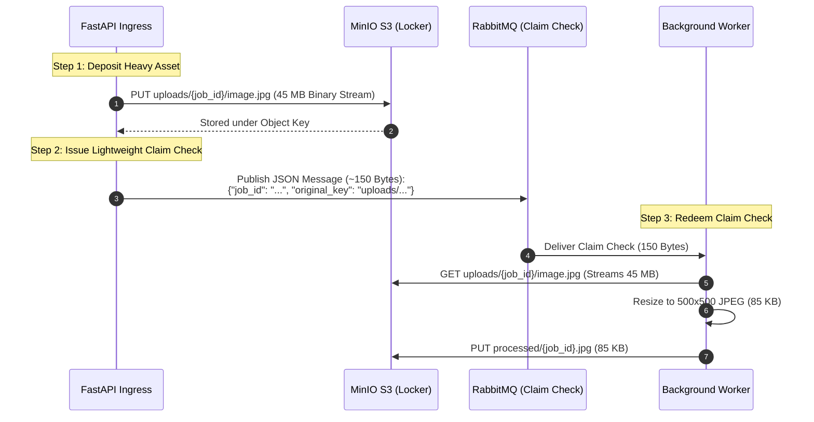

# Comprehensive System Architecture, Core CS & Real-Life Explainer

> **Document:** `SYSTEM_EXPLAINER.md`  
> **Status:** Git-Untracked (Ignored via `.gitignore`)  
> **Target Audience:** Systems Engineers, Technical Interviewers, and Architecture Auditors.

---

## 1. What is the Purpose of This Project?

### 1.1 The Engineering Purpose
The fundamental purpose of this project is to build a **high-throughput, horizontally scalable, fault-tolerant media processing backbone** that decouples user-facing low-latency HTTP traffic from heavy, CPU-bound asset transformations.

In modern software engineering, web applications routinely face a critical architectural trap:
* **APIs are optimized for rapid, non-blocking I/O** (querying databases, authenticating tokens, routing requests).
* **Media processing is strictly CPU-bound** (matrix manipulations, Lanczos pixel resampling, color space transformations, and compression encoding).

When developers mix these two workloads inside the same synchronous request thread, the system collapses under traffic spikes.

**The Purpose of this Project is to:**
1. **Eliminate Server Starvation:** Free API threads immediately by accepting uploads in **$<50\text{ms}$** and returning `HTTP 202 Accepted`.
2. **Decouple Compute from Ingress:** Offload all heavy image matrix calculations to independent background worker nodes.
3. **Achieve True Multi-Core Concurrency:** Bypass Python's Global Interpreter Lock (GIL) by running workers in isolated OS processes and container boundaries.
4. **Enforce Stateless Infrastructure:** Eliminate reliance on local server disks (`/tmp`) by externalizing all asset storage to S3-compatible object storage (MinIO).
5. **Protect Downstream Health:** Use durable message queues (RabbitMQ) with fair-dispatch QoS (`prefetch_count=1`) as a shock absorber against traffic surges.
6. **Eliminate API Egress Bandwidth:** Deliver processed media straight to web browsers via temporary, cryptographically signed S3 Presigned URLs, bypassing API network cards completely.

---

## 2. Real-Life Implementations: Where is This Exact Architecture Used?

This architecture is not just a theoretical pattern; it is the **exact production blueprint** used by the world's highest-scale digital platforms:

```
+---------------------------------------------------------------------------------------------------------+
|                                REAL-WORLD PRODUCTION USE CASES                                          |
+------------------------------+--------------------------------------------------------------------------+
| E-Commerce (Shopify/Amazon)  | Merchant product photo ingestion, thumbnail & gallery zoom generation.   |
| Social Media (Instagram/X)   | User profile avatars, responsive multi-resolution photo feeds.           |
| Fintech & KYC (bKash/Stripe) | National ID, passport, and document verification processing.             |
| Hospitality (Airbnb/Zillow)  | Batch property photography uploads, watermarking, and catalog rendering. |
| Cloud Storage (Dropbox/Drive)| Instant upload confirmation + background thumbnail preview extraction.   |
| Ride-Sharing (Uber/Pathao)   | Driver vehicle registration and document sanitization pipeline.          |
+------------------------------+--------------------------------------------------------------------------+
```

### 2.1 E-Commerce Platforms (e.g., Shopify, Amazon, Daraz, Etsy)
* **The Real-Life Scenario:** A merchant uploads 30 high-resolution 4K product photos of newly manufactured apparel.
* **How This Architecture Solves It:**
  1. The merchant's browser uploads the raw photos to the ingress API.
  2. The API stores the raw master images in S3 and pushes 30 task messages to the queue.
  3. The merchant immediately sees *"Photos uploaded! Optimizing images for catalog..."* in $<1$ second.
  4. Worker clusters pick up the tasks, resize them into responsive sizes (`thumbnail`, `mobile`, `desktop_zoom`), strip GPS metadata, and convert them to WebP/JPEG.
  5. The product listing goes live without ever slowing down the checkout or shopping cart APIs for active shoppers.

### 2.2 Fintech & Digital KYC Onboarding (e.g., bKash, Stripe Identity, Revolut)
* **The Real-Life Scenario:** During account registration, a customer uploads high-res front and back photos of their government National ID / Passport and a selfie for biometric verification.
* **How This Architecture Solves It:**
  1. If KYC verification was synchronous, users would wait 20–40 seconds on a spinning screen while OCR and image cropping run. Many would abandon the app.
  2. With this architecture, the user receives an instant confirmation: *"ID documents received. Verifying your account..."*
  3. Background workers fetch the encrypted image from object storage, crop the document boundaries, compress the file for long-term compliance storage, and run OCR pre-processing.
  4. The result is marked `COMPLETED` in PostgreSQL, and the user receives a push notification when verified.

### 2.3 Social Media & Content Networks (e.g., Instagram, X/Twitter, Pinterest)
* **The Real-Life Scenario:** Millions of users simultaneously upload profile pictures, stories, and post images.
* **How This Architecture Solves It:**
  1. Ingress gateways handle pure network I/O, receiving image streams and writing them straight to object storage.
  2. RabbitMQ absorbs massive spikes (e.g., during New Year's Eve or major sporting events) without dropping packets.
  3. Worker clusters dynamically scale to process the queue, producing square avatar crops and responsive feed resolutions.

### 2.4 Hospitality & Real Estate Portals (e.g., Airbnb, Booking.com, Zillow)
* **The Real-Life Scenario:** A host creates a new property listing and drags-and-drops 60 HDR photographs of their apartment.
* **How This Architecture Solves It:**
  1. Because our worker enforces **Fair Dispatch (`prefetch_count=1`)**, a single host uploading 60 heavy images will not monopolize the entire worker cluster.
  2. RabbitMQ ensures that tasks from other hosts are interleaved and processed fairly in parallel.
  3. Workers watermark the photos, generate thumbnails, and save them back to S3.

### 2.5 Cloud Infrastructure Translation (Mapping to AWS / GCP / Azure)
If you deploy this exact codebase to enterprise cloud providers, every component maps directly to an industry cloud service:

| This Project (Open-Source / Local) | AWS Cloud Equivalent | GCP Cloud Equivalent | Azure Cloud Equivalent |
| :--- | :--- | :--- | :--- |
| **MinIO** | **Amazon S3** | Google Cloud Storage (GCS) | Azure Blob Storage |
| **RabbitMQ** | **Amazon SQS / Amazon MQ** | Google Cloud Pub/Sub | Azure Service Bus |
| **Background Worker** | **AWS ECS Fargate / Lambda** | Cloud Run / Cloud Functions | Azure Container Instances |
| **FastAPI Ingress** | **AWS ECS / EKS / App Runner**| Google Cloud Run / GKE | Azure App Service / AKS |
| **PostgreSQL 17** | **Amazon RDS PostgreSQL** | Cloud SQL for PostgreSQL | Azure Database for PostgreSQL |

---

## 3. What Core Problem Does This Project Solve?

### 3.1 The Synchronous Pitfall: CPU-Bound vs. I/O-Bound Mismatch
In modern web applications, the majority of API endpoints are **I/O-bound** (querying a database, fetching a Redis key, or sending an HTTP request). In I/O-bound tasks, the CPU sits idle while waiting for network packets or disk reads, allowing asynchronous event loops (like Python's `asyncio` / uvloop) to handle thousands of concurrent requests on a single thread.

However, **media processing (image decoding, resampling, resizing, encoding)** is strictly **CPU-bound**:
- Decoding a 4000x3000 JPEG decompresses roughly $12 \times 10^6$ pixels into a raw RGB byte matrix in memory.
- Bilinear/Lanczos resampling requires millions of mathematical matrix multiplications across pixel kernels.
- Re-encoding the image into an optimized JPEG compresses and quantizes discrete cosine transform (DCT) blocks.

### 3.2 The Math of a Synchronous Server Crash
When a developer builds a naive synchronous endpoint (`POST /resize` that resizes the image before returning):

$$\text{Processing Time per Request } (T_{\text{proc}}) \approx 2.5\text{ seconds}$$

If the API server runs on a standard machine with 4 worker threads:
$$\text{Max Throughput} = \frac{4 \text{ workers}}{2.5\text{ s}} = 1.6 \text{ requests/sec}$$

If 10 users upload photos simultaneously:
1. 4 requests occupy the 4 workers.
2. The remaining 6 requests queue up in the OS socket listen backlog (`somaxconn`).
3. While the CPU is pegged at 100%, incoming health checks (`/health`) and lightweight metadata queries cannot be answered.
4. Upstream reverse proxies (Nginx, AWS ALB, Cloudflare) reach their timeout threshold (typically 30s or 60s) and terminate connections with **`504 Gateway Timeout`**.
5. The entire web application goes down for **all users**, even those just browsing text pages!

### 3.3 The Storage Anti-Patterns: Local Disks and DB BLOBs
* **Anti-Pattern A (Local Container Filesystem):** Writing images to `/tmp/uploads` inside a container ties the application to a single instance. In a multi-replica cluster (e.g., Kubernetes or Docker Swarm), a worker running on Node B cannot access a file written by Node A without brittle, slow NFS mounts. Furthermore, container disk overlays wear out host SSDs and risk out-of-disk crashes (`ENOSPC`).
* **Anti-Pattern B (Database BLOBs / BYTEA):** Storing image binary blobs directly in PostgreSQL leads to severe Write-Ahead Log (WAL) bloat, thrashes the database shared buffer pool, degrades index scans, and balloons backup times.

---

## 4. How Each Technology Solves a Specific Piece of the Puzzle

```
+----------------------------------------------------------------------------------------------------+
|                                    TECHNOLOGY ECOSYSTEM                                            |
+----------------------+-----------------------------------------------------------------------------+
| FastAPI              | High-performance ASGI web framework for non-blocking HTTP ingress.          |
| PostgreSQL 17        | ACID relational store for job state tracking, audit history, and querying.  |
| RabbitMQ             | Industrial AMQP message broker for task buffering, durability, & dispatch.  |
| MinIO                | High-speed S3-compatible distributed object storage for media files.        |
| Pillow (PIL)         | Optimized C-extension image manipulation engine for aspect-ratio resizing.  |
| Pydantic v2          | Strict schema validation and serialization for API requests and responses.  |
| Docker Compose       | Container virtualization providing isolated networking and reproducible env.|
+----------------------+-----------------------------------------------------------------------------+
```

### 1. FastAPI (Ingress Presentation Layer)
* **Role:** Serves as the high-speed gateway for the outside world.
* **Why it fits:** Built on Starlette and Pydantic, FastAPI utilizes asynchronous request handling. It handles file stream ingestion and database reads/writes without blocking the main event loop, allowing the API server to sustain massive request rates while workers crunch images in the background.

### 2. PostgreSQL 17 (Metadata & Lifecycle Tracking)
* **Role:** The source of truth for job lifecycle states.
* **Why it fits:** While images live in object storage, applications need structured metadata:
  - *Who uploaded the file?*
  - *What is the current status (`PENDING`, `PROCESSING`, `COMPLETED`, `FAILED`)?*
  - *When was it started and completed?*
  - *What was the exact error message if it failed?*
  PostgreSQL provides transactional integrity (`ACID`), row-level consistency, and fast indexing over UUID keys.

### 3. RabbitMQ (The Asynchronous Buffer & Orchestrator)
* **Role:** The shock absorber and task distributor between the API and Workers.
* **Detailed breakdown below in Section 5.**

### 4. MinIO (S3-Compatible Object Store)
* **Role:** The distributed, stateless storage engine for raw and processed media assets.
* **Detailed breakdown below in Section 5.**

### 5. Pillow (Image Resampling Core)
* **Role:** The image transformation engine executed exclusively by workers.
* **Why it fits:** Pillow is implemented with high-performance C libraries (`libjpeg`, `zlib`). It performs mathematical matrix resampling (`image.thumbnail((500, 500))`) preserving proper aspect ratio, strips heavy metadata, and optimizes JPEG quality to produce crisp, lightweight thumbnails.

### 6. Docker & Docker Compose
* **Role:** Containerization and service orchestration.
* **Why it fits:** Isolates dependencies (Python 3.12, Postgres 17, MinIO, RabbitMQ) into self-contained Linux containers. The internal Docker bridge network allows services to communicate securely via DNS names (`minio:9000`, `rabbitmq:5672`, `db:5432`) without exposing unnecessary ports to the public internet.

---

## 5. How RabbitMQ and MinIO Fit Into the Architecture

### 5.1 The "Claim Check" Enterprise Integration Pattern
A critical architectural question is:  
> *“Why doesn't the API send the 40MB raw image bytes directly inside the RabbitMQ message?”*

#### The Mistake of Heavy Message Payloads:
If the API places a 40MB binary image directly into the RabbitMQ message payload:
1. RabbitMQ stores the message in Erlang process heaps. High queue volumes cause Erlang garbage collector pressure and broker memory thrashing.
2. If RabbitMQ runs out of memory, it triggers a **Broker Alarm**, blocking all socket connections across the entire cluster.
3. Network bandwidth between the API and RabbitMQ is unnecessarily consumed.

#### The Claim Check Solution:
Instead, our system implements the **Claim Check Pattern**:



* RabbitMQ only carries a **tiny JSON claim check** ($\approx 150\text{ bytes}$), allowing the broker to route tens of thousands of messages per second with minimal RAM usage.
* MinIO bears the burden of storing and streaming the heavy binary data.

---

### 5.2 How MinIO Solves Distributed Storage Challenges
1. **Stateless Microservices:** Because MinIO is externalized and accessible over HTTP/S3 API, any number of API containers and any number of worker containers (running across different physical servers or cloud VMs) can interact with the exact same storage pool simultaneously.
2. **Presigned URLs for Zero-Bandwidth Egress:**
   - In a traditional system, when a client downloads a processed image, the API server downloads the file from storage and streams it to the client. This doubles bandwidth and blocks API network sockets.
   - With MinIO, our API server generates an **S3 Presigned URL**. This is a cryptographically signed, expiring URL (valid for 60 minutes) pointing straight to MinIO. The user's browser downloads the thumbnail directly from MinIO, **reducing API server egress bandwidth to zero**!

---

### 5.3 How RabbitMQ Solves Concurrency & Reliability Challenges
1. **Durable Queues & Persistent Delivery:**
   - Queue declared with `durable=True`.
   - Message published with `delivery_mode=pika.DeliveryMode.Persistent`.
   - If the RabbitMQ container is restarted or the physical server loses power, tasks remain safely stored on disk and resume execution when the system reboots.
2. **Fair Dispatch (`prefetch_count=1`):**
   - By default, RabbitMQ pushes messages round-robin. If Worker 1 receives three 50MB RAW files and Worker 2 receives three 100KB GIFs, Worker 1 is frozen for 15 seconds while Worker 2 sits idle.
   - With `basic_qos(prefetch_count=1)`, RabbitMQ holds messages until a worker sends an explicit acknowledgment (`basic_ack`). A fast worker consumes tasks rapidly, while a busy worker is not overloaded.
3. **Poison Pill Isolation:**
   - If a corrupt or malicious file causes Pillow to throw `UnidentifiedImageError`, our worker catches it inside an exception boundary, marks the database record as `FAILED`, and sends `basic_ack` to clear the toxic message from RabbitMQ. The poison pill does not clog the queue or crash subsequent jobs.

---

## 6. Core Computer Science Principles Applied

### 6.1 Queuing Theory & Little's Law
In queueing theory, **Little's Law** governs the behavior of queuing systems:

$$L = \lambda W$$

Where:
* $L$ = Average number of tasks in the system.
* $\lambda$ = Average arrival rate of incoming uploads.
* $W$ = Average time a task spends in the system.

In a naive synchronous server, when arrival rate $\lambda$ exceeds processing capacity $\mu$, waiting time $W$ explodes exponentially:

$$W = \frac{1}{\mu - \lambda}$$

When $\lambda \ge \mu$, the system enters **infinite latency**, leading to socket drops and server death.

**How our architecture solves this:** RabbitMQ acts as a shock absorber (bounded FIFO queue). When a burst of 1,000 users upload files simultaneously:
- The arrival rate $\lambda$ is accepted in $<50\text{ms}$ per request by FastAPI.
- RabbitMQ holds the 1,000 tasks in a durable queue.
- Workers consume tasks at their maximum steady-state rate $\mu$ without CPU degradation.
- System stability is preserved with zero dropped requests.

---

### 6.2 Amdahl's Law and Python's GIL (Global Interpreter Lock)
**Amdahl's Law** defines the theoretical speedup of a system when parallelized:

$$S_{\text{latency}}(s) = \frac{1}{(1 - p) + \frac{p}{s}}$$

Where:
* $p$ is the proportion of execution time that can be parallelized.
* $s$ is the speedup factor of that parallelized portion.

In CPython, the **Global Interpreter Lock (GIL)** prevents multiple native OS threads within a single Python process from executing bytecode simultaneously.
* If you run CPU-bound image transformations across Python threads inside the FastAPI process, the GIL forces them to execute sequentially, while thread switching overhead increases overall latency.
* **Our solution:** We run the worker as a **completely separate OS process** (and in Docker, a dedicated container). This gives the worker its own independent Python interpreter, its own GIL, and its own dedicated CPU core allocation, achieving genuine multi-core hardware parallelization.

---

### 6.3 Asymmetric Cryptographic Signing (HMAC-SHA256)
How does an S3 Presigned URL allow a client to download private files from MinIO without sharing master access keys?

MinIO and our API server share a secret: `MINIO_SECRET_KEY`.
1. The API builds a canonical query string:
   $$\text{CanonicalRequest} = \text{HTTP-VERB} + \text{"\n"} + \text{Bucket} + \text{"\n"} + \text{Key} + \text{"\n"} + \text{ExpiresTimestamp}$$
2. The API computes a Hash-based Message Authentication Code (**HMAC**):
   $$\text{Signature} = \text{HMAC-SHA256}(\text{MINIO\_SECRET\_KEY}, \text{CanonicalRequest})$$
3. The generated URL contains the object key, the expiry timestamp, and the calculated signature.
4. When the browser requests this URL from MinIO:
   - MinIO checks if $\text{CurrentTime} > \text{ExpiresTimestamp}$. If expired, it returns HTTP 403.
   - MinIO independently recomputes the HMAC-SHA256 signature using its internal copy of `MINIO_SECRET_KEY`.
   - If the signatures match byte-for-byte, MinIO authenticates the request and streams the processed thumbnail.

---

### 6.4 AMQP 0-9-1 Protocol Framing vs. Raw Sockets
Instead of building custom TCP socket protocols, the system relies on the **AMQP 0-9-1 specification**:
* **Multiplexed Virtual Channels:** A single TCP connection carries multiple isolated command channels, eliminating the overhead of repeated TCP 3-way handshakes.
* **TCP Keepalives & Heartbeats (`heartbeat=600`):** While the worker process is busy executing Pillow image transformations, it does not send AMQP commands. The Pika heartbeat thread periodically transmits lightweight heartbeat frames to prevent routers and firewalls from dropping the idle TCP connection.

---

## 7. Architectural Comparison Matrix

| Dimension | Naive Synchronous Setup | This Distributed System |
| :--- | :--- | :--- |
| **Ingress Latency** | 2,000 ms – 15,000 ms (Blocking) | **15 ms – 40 ms (Non-Blocking)** |
| **HTTP Response** | `200 OK` (after processing finishes) | **`202 Accepted` (immediately)** |
| **Burst Capacity** | Crashes on 10 concurrent uploads | **Absorbs thousands via RabbitMQ queue** |
| **Storage Portability**| Local filesystem `/tmp` (Tightly coupled) | **MinIO S3 (Stateless, distributed)** |
| **Egress Bandwidth** | API server proxies all file downloads | **S3 Presigned URLs direct to client** |
| **Fault Isolation** | Corrupted image crashes API thread | **Worker traps exception, marks DB FAILED** |
| **Worker Scaling** | Vertical only (bigger API server) | **Horizontal (`docker compose scale worker=5`)** |
| **Process Model** | Single process fighting over GIL | **Isolated process per container** |
